---

## About

I'm Abhinav Dongrajkar, focused on **Cloud & DevOps engineering**, with an interest in AWS infrastructure, Linux administration, networking, and automation.

I use hands-on labs and projects to strengthen my practical understanding of cloud infrastructure and operations.

## Education & Training

- **Education:** B.Sc. Computer Science — Swami Vivekanand Mahavidyalaya, Udgir
- **Cloud Computing training:** Fortune Cloud, Pimpri

## Selected Projects

### AWS Production Architecture Lab
Designed a practice environment involving a custom VPC, Application Load Balancer, target group, launch template, and Auto Scaling Group.

**Topics:** Amazon VPC · Application Load Balancer · Target Groups · Launch Templates · Auto Scaling

### EC2 Instance Scheduler
A learning project for automating EC2 start/stop actions with AWS Lambda, EventBridge Scheduler, and Python Boto3.

**Topics:** Amazon EC2 · AWS Lambda · EventBridge Scheduler · Python · Boto3

### Dedicated MySQL Log Storage
Expanded EBS storage, prepared a filesystem, and mounted the volume at `/mysql-logs` for a storage-administration lab.

**Topics:** Amazon EBS · Linux filesystems · Mounts · Storage administration

### Multi-Region VPC Peering and Transit Gateway
A networking lab exploring connectivity between AWS environments in Mumbai, Northern Virginia, and California.

**Topics:** Amazon VPC · VPC Peering · Transit Gateway · Routing · Multi-region networking

## Skills

- **Cloud:** AWS (EC2, VPC, EBS, ALB, Auto Scaling, Lambda, EventBridge)
- **Operating systems:** Linux
- **Automation & scripting:** Python, Boto3
- **Networking:** VPC peering, Transit Gateway, routing

## GitHub Activity

*Contribution graph is rendered by a third-party service and may occasionally be unavailable.*

## Contribution Activity

## Connect

